# Codyssey E1-1 | 내 컴퓨터에 개발자용 '작업실' 꾸미기

> **과정:** 입학연수 · 개발 입문 · 40시간 · 필수 과제  
> **제출 방법:** 이 GitHub 저장소 주소 제출  
> **실습 범위:** 필수 과제 전체 + 보너스 2개(Docker Compose 기초, Compose 운영 명령어)

## 1. 무엇을 한 과제인가?

개발할 때 필요한 도구를 직접 설치하고, 명령어로 다뤄 보는 과제다. 단순히 설치 화면만 확인하지 않고, **실제로 작동하는지** 명령어 출력과 캡처로 확인했다.

- **Linux CLI:** 터미널에서 파일과 폴더를 관리하고, 접근 권한을 바꾸는 연습
- **Docker:** 프로그램을 컨테이너에 담아 실행하고 관리하는 연습
- **Dockerfile:** 직접 만든 웹페이지를 포함한 NGINX 이미지 제작
- **포트 매핑·바인드 마운트·볼륨:** 웹페이지 접속, 파일 변경 반영, 데이터 보존 확인
- **Git/GitHub:** 회사 PC와 개인 노트북을 오가며 같은 저장소에서 작업
- **보너스:** Docker Compose로 웹 서버를 실행하고 상태·로그를 확인한 뒤 종료

회사 PC에서는 Linux CLI·권한 실습을 진행했다. Docker 이미지를 내려받는 과정에서는 회사 네트워크의 인증서 검증 오류가 발생하여, **개인 노트북에서 Docker 실습을 이어서 완료**했다. 실패한 작업은 성공으로 표시하지 않았다.

## 2. 실습한 컴퓨터와 개발환경

| 항목 | 회사 PC | 개인 노트북 |
|---|---|---|
| 운영체제 | Windows + WSL2 | Windows 11 Pro + WSL2 |
| Linux | Ubuntu 26.04.1 LTS | WSL2 Ubuntu (배포판 버전은 별도 기록하지 않음) |
| 터미널 | VS Code PowerShell, Ubuntu Bash | VS Code PowerShell |
| VS Code | 1.144.0 | 1.143.1 |
| Git | 2.55.0.windows.3 | 2.55.0.windows.3 |
| Docker | Ubuntu Docker Engine 29.1.3 | Docker Desktop 4.97.0, Engine 29.9.2 |
| Docker Compose | 2.40.3 | v5.6.1 |
| Docker 실행 결과 | 엔진 정상, 이미지 다운로드는 실패 | `hello-world`, Ubuntu, NGINX 정상 실행 |

**WSL2와 Docker의 차이:** WSL2는 Windows 안에서 Linux를 사용할 수 있게 해 준다. Docker는 프로그램과 실행에 필요한 파일을 이미지로 묶고, 그 이미지로 컨테이너를 실행한다. WSL2를 설치했다고 Docker가 자동으로 설치되는 것은 아니다.

**PC 이동 시 주의:** GitHub로 공유되는 것은 코드·설정·문서·캡처 **파일**이다. 각 PC의 Docker 이미지, 실행 중인 컨테이너, 볼륨 데이터까지 GitHub로 자동 복사되지는 않는다.

### Ubuntu 설치 확인

회사 PC에서 실행한 명령과 실제 확인 결과:

```bash
whoami                         # neoinkyu
pwd                            # /mnt/c/Users/user/Desktop/코디세이/E1-1 (당시 실행 위치)
cat /etc/os-release            # Ubuntu 26.04.1 LTS
```

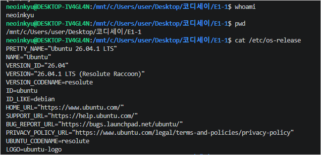

## 3. 전체 수행 체크리스트

| 과제 항목 | 진행 상태 |
|---|---|
| Linux에서 경로·파일·폴더 조작 | ✅ 완료 |
| 파일과 디렉터리 권한 변경 | ✅ 완료 |
| Docker 설치·버전·엔진 확인 | ✅ 완료 |
| `hello-world`와 Ubuntu 컨테이너 실행 | ✅ 완료 |
| 이미지·컨테이너·로그·리소스 운영 | ✅ 완료 |
| 직접 작성한 Dockerfile로 커스텀 이미지 생성 | ✅ 완료 |
| 8080·8081 포트로 웹 서버 접속 | ✅ 완료 |
| 바인드 마운트 변경 전·후 확인 | ✅ 완료 |
| 컨테이너 삭제 후 Docker 볼륨 데이터 유지 | ✅ 완료 |
| Git/GitHub 저장소 연결과 Commit·Push | ✅ 완료 |
| 보너스: Docker Compose 단일 서비스 | ✅ 완료 |
| 보너스: Compose `up`, `ps`, `logs`, `down` | ✅ 완료 |
| Git 설정 및 VS Code 저장소 연동 캡처 | ✅ 완료 |

## 4. 실습 파일 구성

```text
E1-1/
├── README.md                 # 지금 보고 있는 실습 결과 보고서
├── Dockerfile                # NGINX 커스텀 이미지 만드는 방법
├── compose.yaml              # Compose로 웹 서버 실행하는 설정
├── site/
│   └── index.html            # 직접 만든 웹페이지
├── labs/
│   └── e1-1-cli-lab.tar.gz  # 회사 PC의 Linux 실습 파일 백업
├── docs/                     # 작업 당시 남긴 상세 기록(보조 자료)
└── screenshots/              # 실제 실행 화면 21장
    ├── 01-environment/
    ├── 02-cli/
    ├── 03-permissions/
    ├── 04-docker/
    ├── 05-docker-web/
    ├── 06-bind-mount/
    ├── 07-volume/
    ├── 08-compose/
    └── 09-git-github/
```

아래에는 **실제 실행한 명령어, 확인 결과, 캡처를 해당 실습 바로 아래에** 모았다. 다른 문서를 열지 않아도 실습 흐름을 읽을 수 있다.

---

## 5. Linux CLI: 파일과 폴더 다루기

CLI는 마우스 대신 **명령어를 입력해 컴퓨터를 조작하는 방식**이다. Ubuntu 터미널에서 아래 작업을 실행했다.

```bash
# 홈 폴더로 이동하고 연습용 폴더 생성
cd ~
mkdir -p e1-1-cli-lab
cd e1-1-cli-lab
pwd

# 폴더·파일 만들기
mkdir -p workspace/archive
echo "Codyssey E1-1 Linux CLI Practice" > workspace/note.txt
touch workspace/empty.txt
touch workspace/.hidden

# 숨김 파일까지 목록 보기 / 파일 내용 보기
ls -la workspace
cat workspace/note.txt

# 복사 → 이름 변경 → 다른 폴더로 이동
cp workspace/note.txt workspace/note-copy.txt
mv workspace/note-copy.txt workspace/note-renamed.txt
mv workspace/note-renamed.txt workspace/archive/
ls -la workspace/archive

# 절대 경로로 파일 읽기
cat /home/neoinkyu/e1-1-cli-lab/workspace/archive/note-renamed.txt

# 파일과 빈 폴더 지우기
rm workspace/archive/note-renamed.txt
rmdir workspace/archive
ls -la workspace
```

**실제 결과:** 연습용 폴더는 `/home/neoinkyu/e1-1-cli-lab`에 만들어졌다. `ls -la workspace`에서 숨김 파일 `.hidden`과 `note.txt`, `empty.txt`를 확인했다. `cat` 명령으로 다음 내용이 출력됐다.

```text
Codyssey E1-1 Linux CLI Practice
```

**경로 구분:** `/home/neoinkyu/e1-1-cli-lab/workspace/note.txt`처럼 `/`부터 시작하면 **절대 경로**다. 같은 위치에서 `workspace/note.txt`처럼 적으면 **상대 경로**다.

### 파일 생성·내용 확인

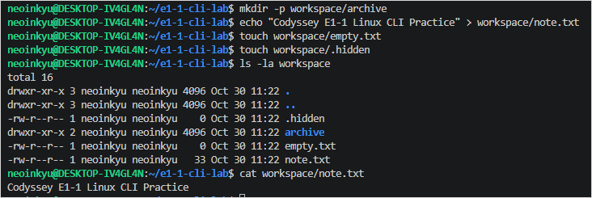

### 파일 복사·이동·삭제

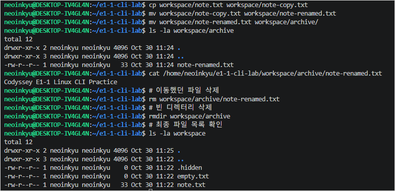

## 6. Linux 파일 권한 바꾸기

Linux는 **소유자·그룹·그 외 사용자**별로 파일 접근 권한을 정한다.

| 표시 | 뜻 | 숫자 |
|---|---|---|
| `r` | 읽기(Read) | 4 |
| `w` | 쓰기(Write) | 2 |
| `x` | 파일 실행 / 폴더 안으로 들어가기(Execute) | 1 |

권한을 숫자로 적을 때는 해당 값을 더한다. 예를 들어 `644`는 소유자에게 읽기+쓰기(`6`), 그룹과 그 외 사용자에게 읽기만(`4`, `4`) 허용한다. `755`는 소유자에게 읽기·쓰기·실행(`7`), 나머지에게 읽기·실행(`5`, `5`)을 허용한다.

```bash
# 파일은 소유자만 읽기·쓰기 가능하도록 변경
chmod 600 workspace/note.txt
# 폴더는 소유자만 접근 가능하도록 변경
chmod 700 workspace

stat -c "%a %A %n" workspace/note.txt
stat -c "%a %A %n" workspace

# 원래 권한으로 복구
chmod 644 workspace/note.txt
chmod 755 workspace
stat -c "%a %A %n" workspace/note.txt
stat -c "%a %A %n" workspace
```

**실제 출력:**

```text
변경 후
600 -rw------- workspace/note.txt
700 drwx------ workspace

복구 후
644 -rw-r--r-- workspace/note.txt
755 drwxr-xr-x workspace
```

파일 하나와 폴더 하나의 권한을 **변경하고, 실제로 바뀌었는지 확인한 뒤 원래대로 복구**했다.


---

## 7. Docker 설치 및 컨테이너 기본 운영

Docker의 **이미지(Image)**는 프로그램을 실행하기 위해 준비된 묶음이고, **컨테이너(Container)**는 그 이미지를 실제로 실행한 것이다. 같은 이미지로 여러 컨테이너를 만들 수 있다.

개인 노트북의 PowerShell에서 아래 명령어를 실행했다.

```powershell
docker --version
docker compose version
docker info
```

**실제 확인 결과:** Docker Engine `29.9.2`, Docker Compose `v5.6.1`이며, `docker info`에 Server 정보가 표시되어 엔진과 연결된 상태를 확인했다.

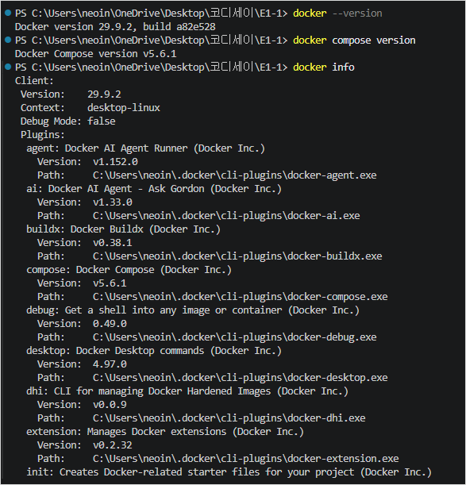

### 7-1. 첫 컨테이너: hello-world

```powershell
docker run --name e1-1-hello hello-world
```

**실제 출력(발췌):**

```text
Unable to find image 'hello-world:latest' locally
Status: Downloaded newer image for hello-world:latest

Hello from Docker!
This message shows that your installation appears to be working correctly.
```

이미지를 PC에 내려받고, 컨테이너를 만들어 실행한 뒤 성공 메시지가 출력됐다. `hello-world`는 메시지를 보여준 뒤 자동으로 종료된다.

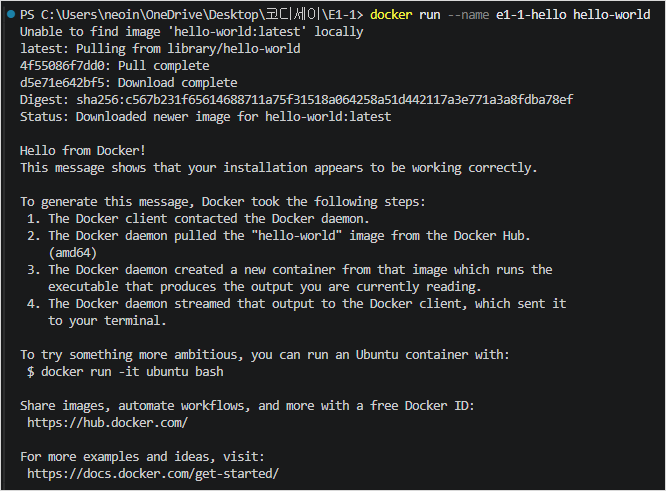

### 7-2. Ubuntu 컨테이너에 들어가 보기

```powershell
docker run -dit --name e1-1-ubuntu ubuntu:24.04 bash
docker exec -it e1-1-ubuntu bash
```

컨테이너 안에서는 Linux 명령어를 실행했다.

```bash
pwd
ls -la
echo "Codyssey E1-1 Docker Practice"
cat /etc/os-release
exit
```

**실제 결과:** Ubuntu `24.04.5 LTS`가 표시됐고 `echo` 명령으로 `Codyssey E1-1 Docker Practice`가 출력됐다. `exit` 후에는 원래 PowerShell 터미널로 돌아왔다.

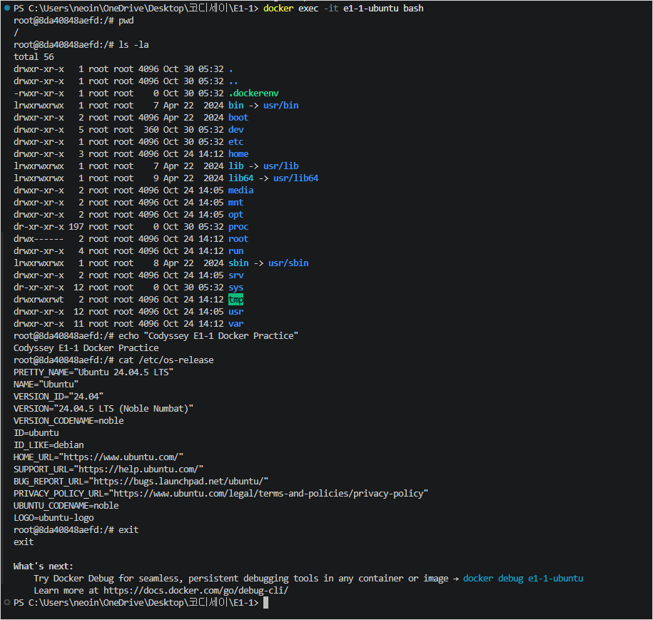

### 7-3. 이미지와 컨테이너 상태 확인

```powershell
docker images
docker ps               # 실행 중인 컨테이너
docker ps -a            # 종료된 컨테이너까지 포함
docker logs e1-1-hello # 실행 로그
docker stats --no-stream  # CPU·메모리 사용량 한 번 확인
```

**실제 결과:** `hello-world:latest`와 `ubuntu:24.04` 이미지를 확인했고, `docker ps -a`에서 실행 중·종료된 컨테이너를 모두 확인했다. `docker stats --no-stream`에서는 CPU와 메모리 사용량이 표시됐다.

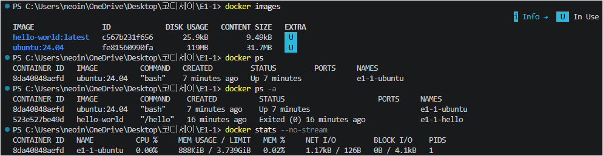

### 7-4. 컨테이너 중지와 재시작

```powershell
docker stop e1-1-ubuntu
docker ps -a
docker start e1-1-ubuntu
docker ps
docker exec e1-1-ubuntu echo "Container is running"
```

**실제 출력:** 중지 후 `Exited (137)` 상태를 확인했고, 다시 시작하니 `Up`으로 표시됐다. `Container is running`도 정상 출력됐다. 종료 코드 137은 종료 과정에서 강제 종료 신호가 사용됐을 가능성을 뜻하지만, 재시작은 성공했다.

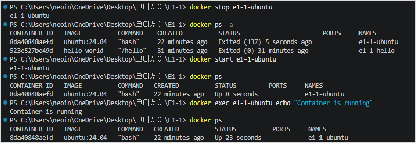

### 7-5. `attach`와 `exec` 비교

```powershell
docker run -dit --name e1-1-attach ubuntu:24.04 bash
docker attach e1-1-attach
# 컨테이너 안에서 echo "Docker attach practice" 입력 후 exit
docker ps -a --filter "name=e1-1-attach"
docker ps --filter "name=e1-1-ubuntu"
```

- **`attach`:** 이미 실행 중인 주 프로세스에 연결한다. 이번에는 Bash에서 `exit`를 입력하자 컨테이너도 `Exited (0)`이 됐다.
- **`exec`:** 실행 중인 컨테이너에 새 명령을 실행한다. `exec`로 들어간 셸에서 `exit`를 입력해도 기존 컨테이너는 계속 실행됐다.

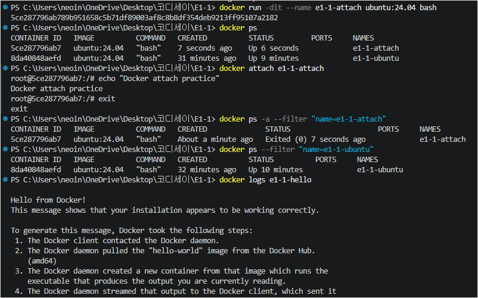

---

## 8. Dockerfile로 나만의 웹 서버 만들기

Dockerfile은 **어떤 이미지를 바탕으로 무엇을 추가할지 적어 놓은 조리법 같은 파일**이다. 이번에는 기존 `nginx:alpine` 이미지에 직접 만든 웹페이지를 넣었다.

### 8-1. 작성한 Dockerfile

저장소 루트의 `Dockerfile` 실제 내용:

```dockerfile
FROM nginx:alpine
LABEL org.opencontainers.image.title="codyssey-e1-1-web"
COPY site/ /usr/share/nginx/html/
EXPOSE 80
```

| 항목 | 쉬운 설명 |
|---|---|
| `FROM` | NGINX가 이미 들어 있는 이미지를 기반으로 시작 |
| `LABEL` | 이미지에 이름표(설명 정보)를 붙임 |
| `COPY` | `site/`에 만든 웹페이지를 컨테이너 안으로 복사 |
| `EXPOSE` | 웹 서버가 내부적으로 80번 포트를 사용한다는 것을 표시 |

### 8-2. 웹페이지 소스

`site/index.html`에 HTML 문서를 직접 작성했다. 현재 저장소에는 **바인드 마운트 실습에서 수정한 문구**가 저장되어 있다.

```html
<!DOCTYPE html>
<html lang="ko">
<head>
  <meta charset="UTF-8">
  <title>Codyssey E1-1</title>
  <style>
    body {
      font-family: Arial, sans-serif;
      background: #f3f6fa;
      text-align: center;
      padding: 100px 20px;
    }
    h1 { color: #174ea6; }
    p { color: #444; font-size: 20px; }
  </style>
</head>
<body>
  <h1>Codyssey E1-1</h1>
  <p>My First Docker Web Server</p>
  <p>Bind Mount - LIVE UPDATE!</p>
</body>
</html>
```

### 8-3. 직접 이미지 빌드

```powershell
docker build -t e1-1-web:1.0 .
docker images
```

**실제 결과:** `Building (7/7) FINISHED`가 출력됐고 이미지 목록에 `e1-1-web:1.0`이 생겼다.

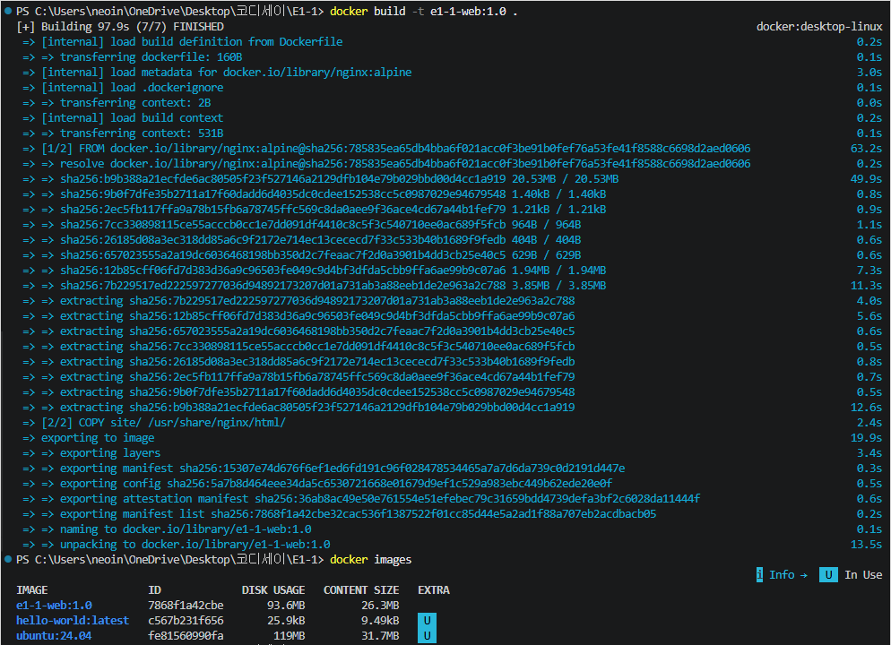

### 8-4. 포트 매핑으로 웹페이지 접속

컨테이너 안의 NGINX는 **80번 포트**를 사용한다. Windows 브라우저에서 열려면 호스트 포트와 연결해야 한다. 이 연결을 **포트 매핑**이라고 한다.

```powershell
docker run -d --name e1-1-web-8080 -p 127.0.0.1:8080:80 e1-1-web:1.0
docker run -d --name e1-1-web-8081 -p 127.0.0.1:8081:80 e1-1-web:1.0
docker ps
curl.exe http://localhost:8080
curl.exe http://localhost:8081
```

- `127.0.0.1:8080:80`: **내 PC의 8080 → 컨테이너의 80** 연결
- `127.0.0.1:8081:80`: **내 PC의 8081 → 다른 컨테이너의 80** 연결
- `127.0.0.1`을 사용하여 접속 범위를 내 PC로 제한

**실제 결과:** 8080과 8081에서 동일한 커스텀 웹페이지가 열렸다. 브라우저 주소창까지 함께 캡처했다.

**8080 포트 접속 화면**

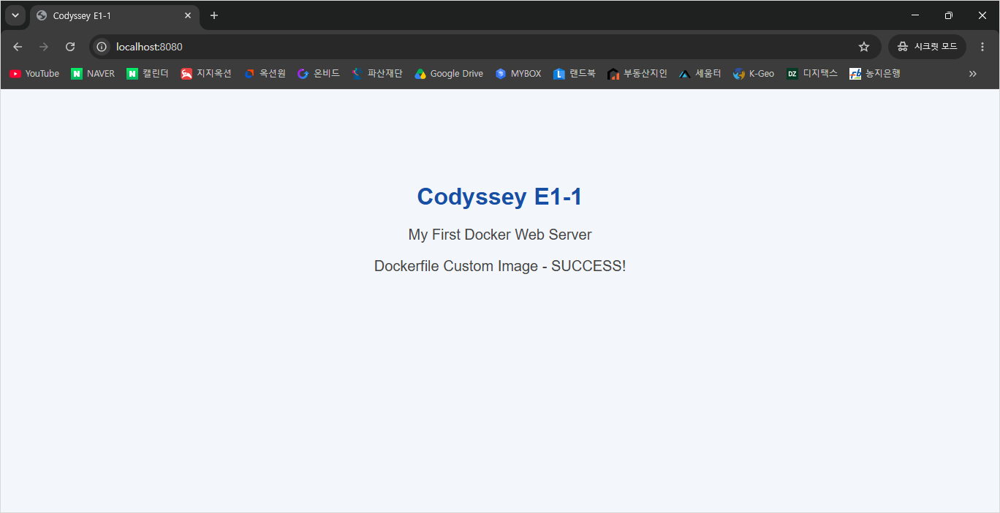

**8081 포트 접속 화면**

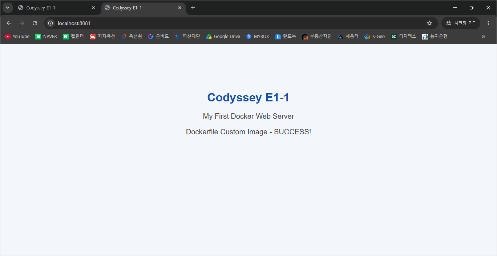

---

## 9. 바인드 마운트: 파일만 고쳐도 웹페이지가 바뀔까?

**바인드 마운트(Bind Mount)**는 PC에 있는 폴더를 컨테이너 안의 폴더와 연결하는 방법이다. 파일을 수정할 때마다 Docker 이미지를 다시 빌드하지 않아도 된다.

이번에는 기존 8080·8081 컨테이너는 그대로 두고 **8082 포트**에서 마운트 실습을 했다.

```powershell
$sitePath = (Resolve-Path .\site).Path
docker run -d --name e1-1-web-bind -p 127.0.0.1:8082:80 --mount "type=bind,source=$sitePath,target=/usr/share/nginx/html,readonly" e1-1-web:1.0
docker inspect e1-1-web-bind --format '{{json .Mounts}}'
```

`readonly`는 **컨테이너 쪽에서 PC 원본 파일을 수정하지 못하게** 하는 옵션이다. PC에서 파일을 고치는 것은 가능하다.

### 변경 전 화면

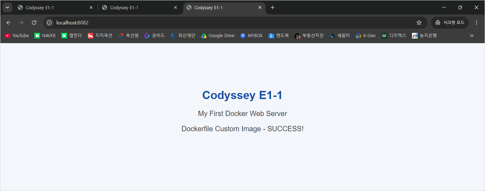

Windows의 `site/index.html`에서 기존 문구를 `Bind Mount - LIVE UPDATE!`로 바꿨다. **이미지를 다시 빌드하거나 컨테이너를 재시작하지 않았다.**

### 변경 후 화면

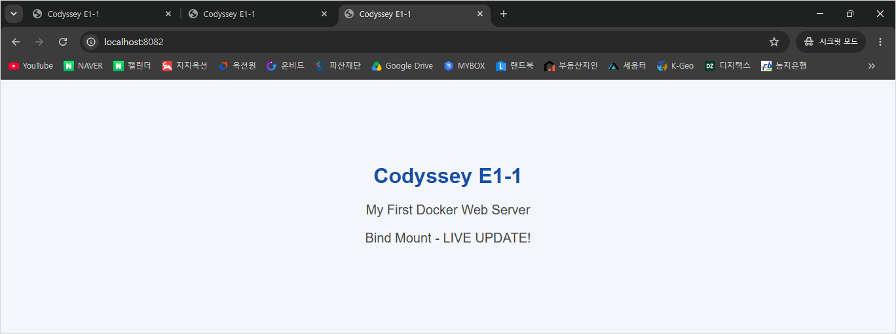

### 두 포트의 내용을 비교한 실제 결과

```powershell
curl.exe -s http://localhost:8080 | Select-String "Dockerfile Custom|Bind Mount"
# <p>Dockerfile Custom Image - SUCCESS!</p>

curl.exe -s http://localhost:8082 | Select-String "Dockerfile Custom|Bind Mount"
# <p>Bind Mount - LIVE UPDATE!</p>
```

8080은 이미지 안에 들어 있는 **기존 파일**을 계속 보여주고, 8082는 **PC의 변경된 파일**을 보여준다. 이것이 바인드 마운트의 핵심이다.

> **다른 PC에서 그대로 재현할 때:** GitHub에 저장된 `site/index.html`은 이미 수정된 버전이다. 변경 전·후를 똑같이 보려면 먼저 HTML의 문구를 `Dockerfile Custom Image - SUCCESS!`로 되돌려 이미지를 빌드한다. 이후 8082 마운트 컨테이너를 실행한 다음 파일을 `Bind Mount - LIVE UPDATE!`로 바꾸고 새로고침한다. 이때 **다시 빌드하지 않아야** 실습 차이를 확인할 수 있다.

---

## 10. Docker 볼륨: 컨테이너를 삭제하면 데이터도 사라질까?

**Docker 볼륨(Volume)**은 Docker가 관리하는 데이터 보관 장소다. 컨테이너를 삭제하더라도 **볼륨 자체를 삭제하지 않으면** 그 안의 데이터를 유지할 수 있다.

### 10-1. 볼륨을 만들고 데이터 저장

```powershell
docker volume create e1-1-data
docker volume ls
docker run -d --name e1-1-volume-first --mount type=volume,source=e1-1-data,target=/data ubuntu:24.04 sleep infinity
docker exec e1-1-volume-first sh -c "echo E1-1_VOLUME_PERSISTENCE_OK > /data/hello.txt"
docker exec e1-1-volume-first cat /data/hello.txt
```

**실제 출력:**

```text
E1-1_VOLUME_PERSISTENCE_OK
```

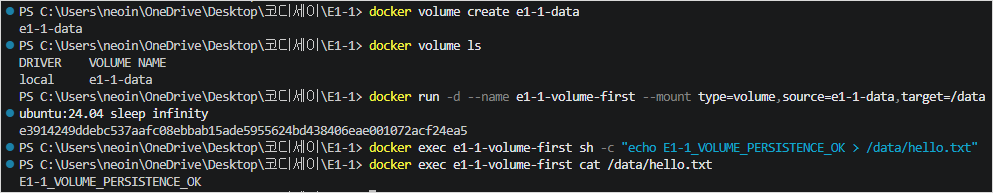

### 10-2. 컨테이너 삭제 후 새 컨테이너에서 읽기

```powershell
docker rm -f e1-1-volume-first
docker ps -a --filter "name=e1-1-volume-first"
docker volume ls

docker run -d --name e1-1-volume-second --mount type=volume,source=e1-1-data,target=/data ubuntu:24.04 sleep infinity
docker exec e1-1-volume-second cat /data/hello.txt
docker volume inspect e1-1-data
```

**실제 출력:**

```text
E1-1_VOLUME_PERSISTENCE_OK
```

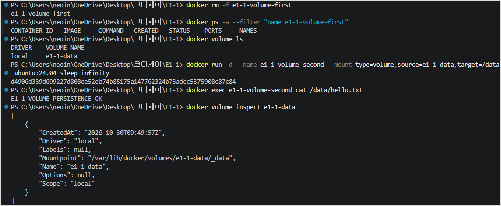

**결론:** 첫 번째 컨테이너를 삭제하고 두 번째 컨테이너를 만들었지만, **같은 볼륨을 연결하니 파일 내용이 그대로 남아 있었다.**

---

## 11. 보너스 과제: Docker Compose 실행과 관리

**Docker Compose**는 컨테이너를 실행할 때 필요한 설정을 `compose.yaml` 파일 하나에 적는 도구다. 긴 `docker run` 명령을 매번 다시 입력하지 않아도 된다.

이번에는 **단일 NGINX 웹 서버**만 실행했다. 멀티 컨테이너, 환경변수, SSH 키 설정 보너스는 수행 범위에서 제외했다.

### 11-1. 작성한 Compose 파일

```yaml
services:
  web:
    build: .
    image: e1-1-web:compose
    ports:
      - "127.0.0.1:8083:80"
```

### 11-2. 실행·상태·로그 확인

```powershell
docker compose config
docker compose up -d --build
docker compose ps
curl.exe http://localhost:8083
docker compose logs --tail 20 web
```

**실제 결과:** `e1-1-web-1` 컨테이너가 실행됐고, `http://localhost:8083`에서 웹페이지 HTML이 출력됐다. NGINX 로그에서 `GET / HTTP/1.1` 요청이 **HTTP 200**으로 처리된 것도 확인했다.

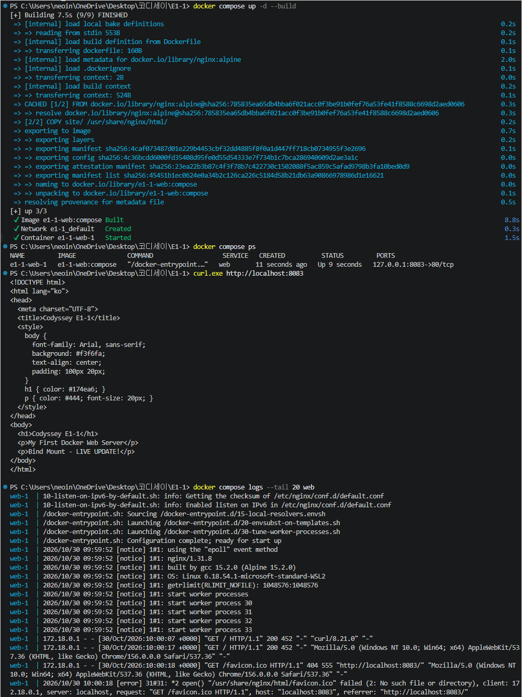

### 11-3. 종료 및 제거 확인

```powershell
docker compose down
docker compose ps -a
```

**실제 결과:** Compose가 만든 컨테이너와 네트워크가 제거됐고 `docker compose ps -a` 목록이 비어 있었다. **다른 실습에서 만든 컨테이너와 볼륨을 지우는 작업은 아니다.**

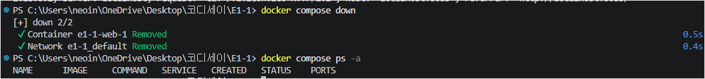

---

## 12. Git/GitHub: 다른 PC에서 같은 작업을 이어 하기

- **Git:** 현재 PC에서 파일의 변경 이력을 저장한다. 변경을 하나의 기록으로 남기는 작업이 `commit`이다.
- **GitHub:** 그 기록을 인터넷 저장소에 올려 다른 PC에서도 내려받을 수 있게 한다.
- **VS Code:** 소스 제어 메뉴에서 변경사항과 Commit 이력을 확인할 수 있다.

### 12-1. Git 설정 확인

```powershell
git config --list
git branch --show-current
git remote -v
```

**실제 확인된 내용:** 개인 노트북의 현재 브랜치는 `main`, 원격 저장소는 `https://github.com/neoinkyu/E1-1.git`이었다. Git 작성자 이름·이메일 및 기본 브랜치 설정은 아래 **실제 설정 화면**을 증거로 남겼다.

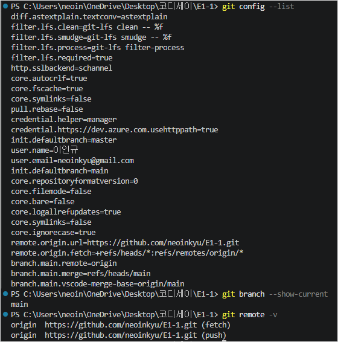

### 12-2. VS Code에서 원격 저장소 연결 확인

VS Code의 소스 제어 화면에서 **Commit 이력**, 현재 브랜치 `main`, 원격 브랜치 `origin/main`을 확인했다. 터미널에서도 다음 결과를 확인했다.

```powershell
git status
# On branch main
# Your branch is up to date with 'origin/main'.

git remote -v
# origin https://github.com/neoinkyu/E1-1.git (fetch)
# origin https://github.com/neoinkyu/E1-1.git (push)

git log -1 --oneline
# 7486291 feat: complete Docker web storage and Compose labs
```

아래 화면은 **VS Code에서 GitHub 원격 저장소와 연결된 Git 작업을 관리하고 있다는 증거**다. 별도의 VS Code GitHub 계정 로그인 팝업은 촬영하지 않았다.

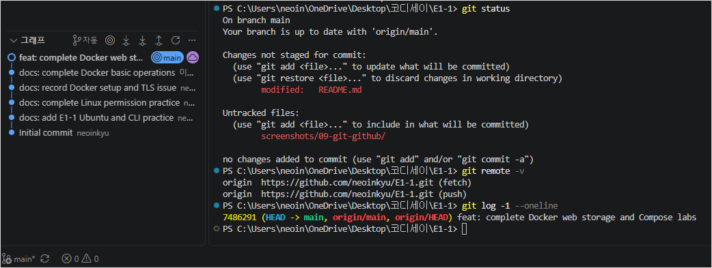

### 12-3. PC를 옮길 때 사용하는 명령

```powershell
# 첫 PC에서 한 번: GitHub 저장소 복제
git clone https://github.com/neoinkyu/E1-1.git
cd E1-1

# 작업 시작: 최신 파일 내려받기
git status
git pull --ff-only origin main

# 작업 종료: 파일 확인·기록·업로드
git status
git add README.md Dockerfile compose.yaml site/ docs/ screenshots/
git diff --cached --stat
git commit -m "docs: update E1-1 practice"
git push origin main
```

**실제 결과:** 회사 PC와 개인 노트북에서 같은 원격 저장소의 `main` 브랜치로 Commit·Push했다. Docker 실습 완료 당시에는 `7486291` Commit과 `working tree clean`을 확인했다.

---

## 13. 트러블슈팅: 실제로 겪은 문제 4건

트러블슈팅은 **문제 발생 → 원인 추정 → 확인 → 해결 또는 대안**의 과정이다. 이 과제에서 실제 겪은 사례만 기록했다.

### 사례 1. Git Commit이 되지 않음 — 해결

- **문제:** 회사 PC에서 `git commit`을 실행하자 `Author identity unknown` 오류가 표시됐다.
- **원인:** Git 작성자 이름과 이메일이 설정되지 않았다.
- **조치:** 해당 저장소에서 `git config --local user.name`과 `git config --local user.email`로 작성자 정보를 등록했다.
- **결과:** Commit이 성공했고 GitHub Push까지 완료했다.

```text
fatal: unable to auto-detect email address
→ 작성자 정보 등록 후 Commit·Push 성공
```

### 사례 2. 회사 PC에서 Docker 패키지를 찾지 못함 — 설치 해결

- **문제:** `docker-ce has no installation candidate`가 발생했다.
- **원인 확인:** Docker 저장소가 참조하는 GPG 키 파일이 없었다. 키 다운로드를 시도하니 SSL 인증서 검증 오류가 발생했다.
- **대안:** Docker 공식 저장소 대신 Ubuntu 기본 저장소의 Docker 패키지를 사용했다.
- **결과:** Docker Engine `29.1.3`, Compose `2.40.3` 설치 및 엔진 실행을 확인했다.

### 사례 3. 회사 PC에서 Docker Hub 이미지 다운로드 실패 — PC 변경으로 과제 진행

- **문제:** `hello-world` 다운로드에서 `x509: certificate signed by unknown authority` 오류가 발생했다.
- **원인 확인:** HTTPS 인증서 발급자가 회사 네트워크 보안 솔루션의 CA로 표시됐다. Ubuntu가 이를 신뢰하지 못하는 것으로 판단했다.
- **조치:** 인증서 검증을 끄지 않고 회사 PC에서 다운로드 실습을 중단했다.
- **대안 및 결과:** 개인 노트북에서 동일한 Docker 실습을 다시 진행했고 `Hello from Docker!`가 출력됐다.
- **남은 상태:** **회사 PC 자체의 인증서 오류는 해결하지 않았다.**

```text
회사 PC: tls: failed to verify certificate: x509: certificate signed by unknown authority
개인 노트북: Hello from Docker!
```

### 사례 4. 개인 노트북에서 Docker 명령어가 인식되지 않음 — 해결

- **문제:** Docker Desktop 설치 직후 PowerShell에서 `docker` 명령을 찾지 못했다.
- **원인 추정:** VS Code가 설치 전의 환경변수(PATH)를 그대로 사용했을 가능성이 있었다.
- **조치:** VS Code를 완전히 종료하고 다시 실행했다.
- **결과:** `docker --version` → `29.9.2`, `docker compose version` → `v5.6.1` 출력으로 확인했다.

---

## 14. 다른 PC에서 재현하는 순서

다음 절차는 처음 보는 사람이 이 저장소의 파일로 웹 서버를 다시 실행하기 위한 안내다.

1. **준비:** Git, Docker Engine 또는 Docker Desktop을 설치한다. Windows라면 WSL2 기반 Docker Desktop을 사용할 수 있다. 설치 후 Docker 엔진이 실행 중인지 확인한다.
2. **파일 받기:** 빈 폴더에서 `git clone https://github.com/neoinkyu/E1-1.git`을 실행한다.
3. **Docker 확인:** `docker --version`, `docker compose version`, `docker info`로 설치 상태를 확인한다.
4. **웹 서버 실행:** 저장소 폴더에서 `docker build -t e1-1-web:1.0 .` 실행 후 `docker run -d --name e1-1-web-8080 -p 127.0.0.1:8080:80 e1-1-web:1.0` 실행. 브라우저에서 `http://localhost:8080` 접속.
5. **마운트 확인:** 9절의 명령으로 8082 컨테이너 실행 후 HTML을 수정하고 새로고침한다.
6. **볼륨 확인:** 10절처럼 같은 이름의 볼륨을 두 컨테이너에서 사용해 데이터를 비교한다.
7. **Compose 확인:** `docker compose up -d --build`로 시작하고 `docker compose ps`, `docker compose logs --tail 20 web`, `docker compose down`으로 상태를 확인하고 종료한다.

**재현 시 알아둘 점:** 현재 `site/index.html`은 바인드 마운트 실습 **후**의 파일이므로, 9절의 변경 전 화면을 재현하려면 HTML 문구를 먼저 되돌려야 한다. PC마다 폴더 경로가 달라질 수 있고, 이름이 같은 컨테이너가 이미 있으면 새로 생성하기 전에 상태를 확인해야 한다. **볼륨 자체를 삭제하는 명령은 데이터 손실을 일으킬 수 있으므로 주의한다.**

---

## 15. 최종 정리

이번 과제를 통해 Linux 터미널, Docker, Git/GitHub를 하나의 개발 흐름으로 연결했다. **개발 도구를 설치하는 것뿐 아니라, 실제 실행하고 결과를 확인하는 것이 중요하다**는 점을 경험했다. 특히 Docker 이미지 하나로 웹 서버를 여러 포트에서 실행하고, 바인드 마운트와 볼륨으로 파일 변경·데이터 보존의 차이를 확인했다.
