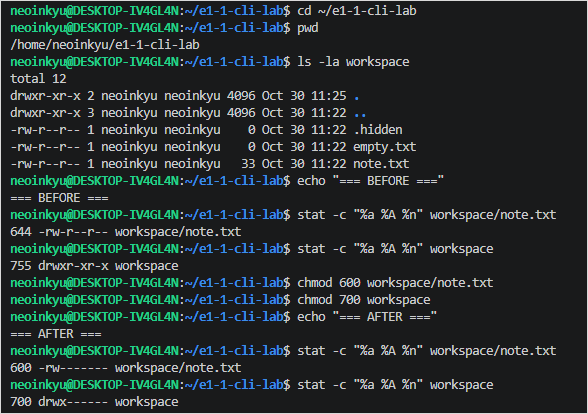

# E1-1 실습 진행 기록

## 2026-10-30 / 회사 PC

### 개발환경
- Windows + WSL2
- Ubuntu 26.04.1 LTS
- Linux 사용자: neoinkyu
- Git: 2.55.0.windows.3
- VS Code: 1.144.0

### 완료
- WSL2 및 Ubuntu 설치
- Linux 사용자 계정 생성
- pwd, ls, cd, mkdir 명령 실습
- touch, echo, cat 명령 실습
- cp, mv, rm, rmdir 명령 실습
- Linux 실습 파일 백업
- CLI 캡처 2장 확보

### 다음 작업
- Linux 파일 및 디렉터리 권한 변경
- Docker 설치 및 기본 실습

### 주의
- 회사 PC의 Ubuntu 내부 데이터는 다른 PC와 자동 동기화되지 않음
- 각 PC에서 Linux 및 Docker 환경 별도 확인 필요

## Linux 파일 및 디렉터리 권한 실습

- 실습 환경: Ubuntu 26.04.1 LTS / WSL2
- 실습 위치: /home/neoinkyu/e1-1-cli-lab
- 수행 결과: 정상 완료

### 권한 변경 및 검증

```bash
chmod 600 workspace/note.txt
chmod 700 workspace
stat -c "%a %A %n" workspace/note.txt
# 600 -rw------- workspace/note.txt
stat -c "%a %A %n" workspace
# 700 drwx------ workspace
```

### 권한 원상복구

```bash
chmod 644 workspace/note.txt
chmod 755 workspace
stat -c "%a %A %n" workspace/note.txt
# 644 -rw-r--r-- workspace/note.txt
stat -c "%a %A %n" workspace
# 755 drwxr-xr-x workspace
```

### 증거자료




## Docker 설치 및 실행 실습

- 실습 환경: 회사 PC / WSL2 / Ubuntu 26.04.1 LTS
- Docker Engine: 29.1.3
- Docker Compose: 2.40.3
- Docker Buildx: 0.30.1
- Docker 서비스: active

### 설치 과정의 문제

Docker 공식 저장소에서 인증서 검증 오류가 발생하여
Docker CE 패키지를 설치하지 못함.

대안으로 Ubuntu 기본 패키지 저장소를 사용하여
Docker Engine 및 Compose 설치 완료.

### 컨테이너 실행 검증

실행 명령:

```bash
sudo docker run --name e1-1-hello hello-world
```

실행 결과:

```text
tls: failed to verify certificate:
x509: certificate signed by unknown authority
```

회사 네트워크의 HTTPS 검사에 따른 인증서 신뢰 문제 확인.

### 후속 조치

회사 PC에서는 추가적인 인증서 설정을 하지 않기로 결정.
교육장 PC 또는 개인 노트북에서 Docker 컨테이너 실습을 계속 진행.

※ Docker 엔진 설치는 성공했으나,
   hello-world 실행은 성공하지 못했음.
